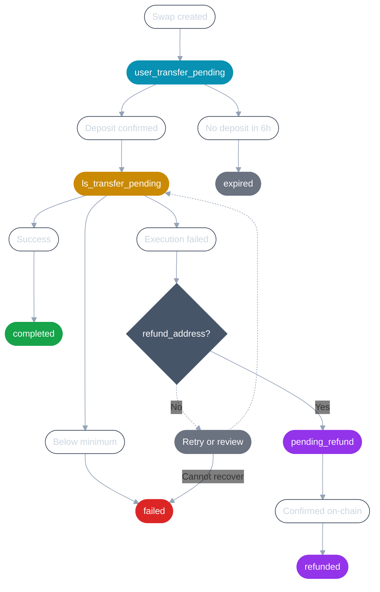

A swap progresses through seven API statuses. The diagram shows the main paths; recovery depends on the failure.

## Flow

### 1. `user_transfer_pending`

Swap is created. Layerswap is waiting for the user to complete the transaction in the source network.

- If no deposit arrives within **6 hours** → `expired`
- Once the deposit is confirmed with enough confirmations → `ls_transfer_pending`

### 2. `ls_transfer_pending`

Layerswap is processing the swap. If something goes wrong during execution:

- If deposited amount is **below the minimum** → `failed`
- Layerswap may retry failed operations. Retry behavior and timing depend on the failure.
- **With `refund_address`** → a failure eligible for an automatic refund moves to `pending_refund`.
- **Without `refund_address`** → the swap may remain `ls_transfer_pending` during retries or investigation, or move to `failed` if automatic recovery is exhausted.
- If execution succeeds → `completed`

### 3. `completed`

Funds are delivered to the destination address.

### 4. `pending_refund` → `refunded`

Refund is sent to `refund_address` on the source chain in the source token, **minus gas fees**. If the refund amount is less than the gas fee, no refund is issued. See [Refunds](/concepts/refunds) for details.

## What can go wrong

| Scenario | What to expect |
|---|---|
| Deposited less than minimum | `failed`; inspect `fail_reason` |
| No liquidity or route available, slippage cannot be met, or a network/provider fails | Layerswap may retry. Recovery can require a refund, end in `failed`, or require investigation. Follow the returned status and `fail_reason`. |

See [Refunds](/concepts/refunds) for the refund flow and address requirements.

## Transaction-level detail

A swap can include multiple transactions, such as the deposit, payout, refuel, or refund. Each transaction has its own `type` and `status`. Use the transaction status to track that specific on-chain operation, use the swap-level `status` to track the overall swap lifecycle.

## Filtering swaps by status

Status names used in API responses are different from those accepted by the `GET /swaps` filter. For example, a swap response uses `pending_refund`, while the corresponding filter value is `PendingRefund`.

See [Track swaps](/api/track-swaps) for the complete list of filter values.

## Observing status changes

- **API**: poll [`GET /swaps/{id}`](/api-reference/swaps/get-swap-details), or look up by funding transaction with [`GET /swaps/by_transaction_hash/{hash}`](/api-reference/swaps/get-swap-by-transaction-hash).
- **Webhooks**: receive dashboard-configured status updates — [Webhooks](/api/webhooks).
- **Widget**: use [`onSwapStatusChange`](/widget/events/on-swap-status-change) for observed backend status transitions and [`onSwapLifecycle`](/widget/events/on-swap-lifecycle) for UI phases, wallet actions, retries, and refunds. UI progress can lead the API; neither callback replaces server-side fulfillment verification.

Follow the [polling guidance](/api/track-swaps#polling-guidance): back off when the swap is unchanged or requests fail, and stop at a terminal status.

## Next

[Build your first API swap](/api/quickstart) applies this lifecycle end to end. [Refunds](/concepts/refunds) explains refund handling, addresses, fees, and transaction data. [Track swaps](/api/track-swaps) covers polling, filters, and transaction-hash lookup.
